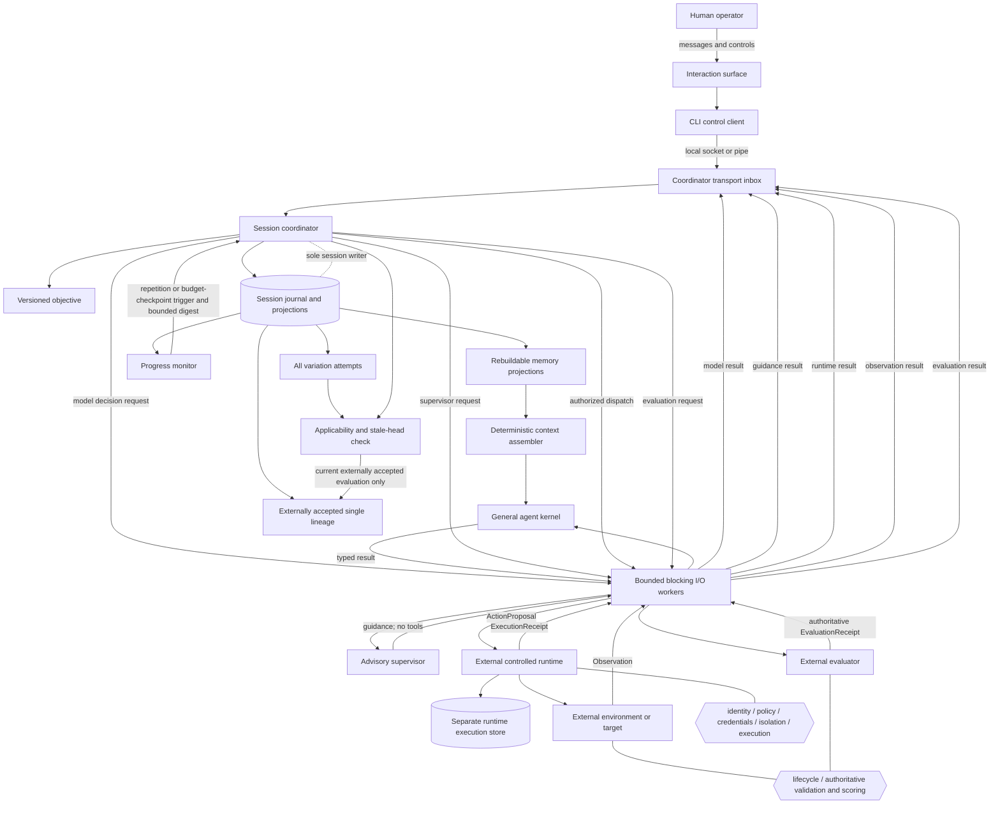
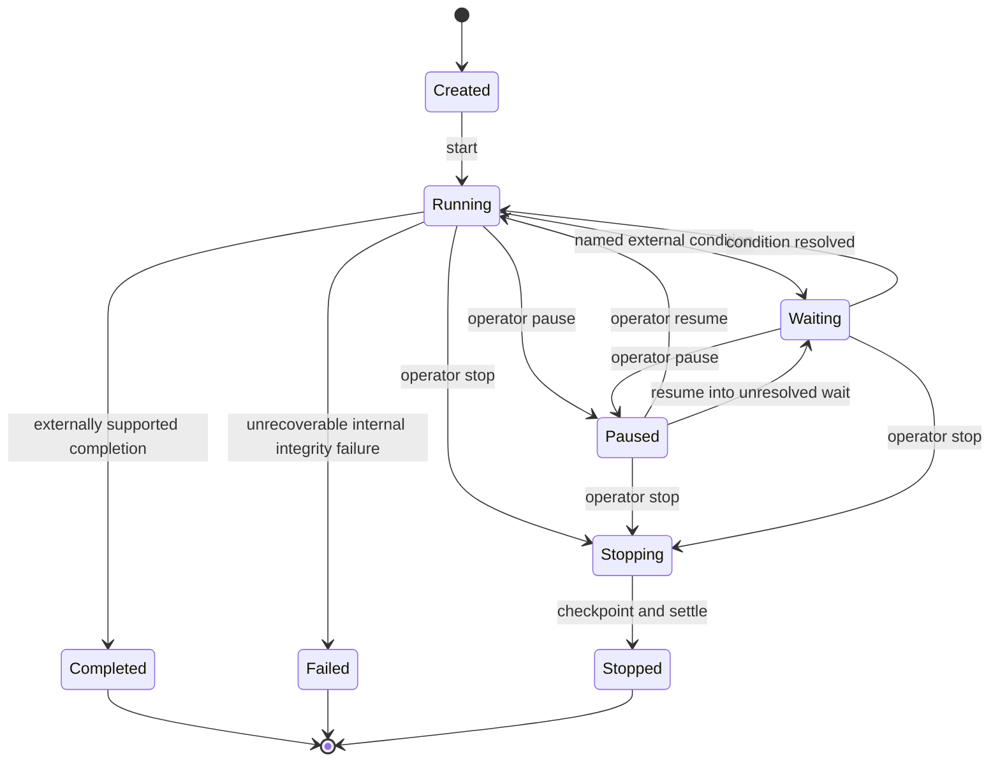

# Vharness Next system and control flow

This cross-document view represents ARCH-0001, ADR-0001 through ADR-0005, and
ADR-0019, which supersedes ADR-0007.
Arrows crossing the runtime boundary are proposals and receipts, never direct
Vharness execution authority. The coordinator alone writes session state;
runtime records live in a distinct store owned by the runtime worker.

## Notes and unresolved branches

The initial coordinator has one event writer, at most one unresolved
state-changing proposal per session, and one committed lineage. An attempt may
span many actions; only external acceptance advances lineage. Waiting names a
specific external condition and does not imply completion or new authority.
Workers may perform blocking model, supervisor, and runtime calls, but cannot
schedule or dispatch independently or write session state. CLI controls use
local IPC to the coordinator; in-process workers return through its bounded
inbox. Runtime storage is separate from the session database. Evaluation intake
may be retained while paused or stopped but is consumed only if applicable and
schedulable; Stopped remains terminal. Killing a process does not reverse its
effects. Population/archive branching is deferred. PHASE-0004 treats runtime
delivery and campaign validation as independent gates (ADR-0019), while all
four campaign families remain necessary for full verification.
